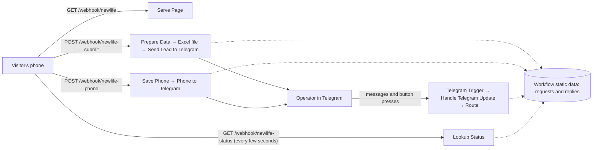

# New Life — consultation request page (n8n + Telegram)

A mobile-first request page for **New Life (نیو لایف)** aesthetic clinic, built as a single **n8n** workflow.
Visitors pick services and send a consultation request from their phone; the request lands in **Telegram** with an Excel file and action buttons; the clinic's reply appears on the visitor's page within seconds.


---

## Contents

- [What it does](#what-it-does)
- [How it works](#how-it-works)
- [Requirements](#requirements)
- [Setup (Windows, Docker, free ngrok)](#setup-windows-docker-free-ngrok)
- [Daily use in Telegram](#daily-use-in-telegram)
- [Customising](#customising)
- [Data, limits and good to know](#data-limits-and-good-to-know)
- [Troubleshooting](#troubleshooting)
- [Security](#security)
- [Repository layout](#repository-layout)

---

## What it does

**For the visitor (Persian, right-to-left, phone-sized)**

- Light sky-blue page that works like a mobile app: one column, large tap targets, the send button always at the bottom.
- Services in **three categories**, each a tab with its own colour and a count of picked items:
  `کاشت مو، ابرو و ریش` · `جراحی‌های زیبایی` · `زیبایی بدون جراحی`
- Only the first name and one service are required. If the **mobile number is missing**, a warning sheet asks for it (the visitor can type it right there, or still send without it).
- After sending, a status screen shows the **place in the queue**, a live wait timer and four steps: ثبت شد → در صف بررسی → پاسخ داده شد → تکمیل شد.
- If no number was given, the status screen keeps asking for one; a number added later is forwarded to Telegram.
- The clinic's replies appear on the same page. Reloading, or coming back later in the same browser, shows the same request.

**For the clinic (Telegram)**

- Every request arrives with an Excel file and three buttons:
  - **✍️ پاسخ به متقاضی** — opens a reply box; the text appears on the visitor's page.
  - **📞 درخواست شماره** — asks the visitor, on their page, to enter a mobile number.
  - **✅ اتمام درخواست** — finishes the request, removes it from the waiting list, and the page shows "تکمیل شد". Replying again reopens it.
- **/list** (or the **📋 لیست انتظار** keyboard button) shows the waiting list: requests with no reply yet, then answered ones still open.
- Only the configured operator account can use the bot.

---

## How it works



| Method | Path | Used for |
|---|---|---|
| GET | `/webhook/newlife` | The page itself (the link you share) |
| POST | `/webhook/newlife-submit` | Sending a request |
| GET | `/webhook/newlife-status?t=…` | The page checking for replies (polling) |
| POST | `/webhook/newlife-phone` | Adding a mobile number after sending |
| POST | `/webhook/<id>/webhook` | Telegram updates — registered automatically when the workflow is activated |

The page finds the other three addresses from its own address, so `…/webhook/newlife` is the only link you share.

**Request states:** `waiting` (no reply yet) → `answered` → `closed` (finished). A reply to a closed request reopens it.

**Workflow nodes (29):** 4 webhooks · 6 code nodes · 2 IF + 1 Switch · 6 Telegram nodes + 1 Telegram Trigger · 6 respond nodes · 1 Excel converter · 2 sticky notes with setup notes.

---

## Requirements

| What | Notes |
|---|---|
| **n8n** (self-hosted) | A recent n8n version; the workflow uses Code v2, Switch v3.2 and Telegram v1.2 nodes. This guide runs it in **Docker Desktop** on Windows. |
| **A public HTTPS address** | Telegram and visitors must reach n8n. This guide uses **ngrok free**, which gives each account one fixed address like `https://abc-def-ghi.ngrok-free.dev`. |
| **A Telegram bot** | Created with [@BotFather](https://t.me/BotFather). |
| **Internet access to `api.telegram.org`** from the computer running n8n | In regions where Telegram is filtered, the VPN must cover Docker/n8n too (system-wide/TUN mode), not only the browser. |

---

## Setup (Windows, Docker, free ngrok)

> Commands below are for **cmd** (Command Prompt). In PowerShell the syntax for variables is different.

### 1. Create the Telegram bot

1. In Telegram open **@BotFather** → `/newbot` → choose a name and a username.
2. Copy the **token** it gives you. Keep it private — anyone with it controls the bot.

### 2. Get your ngrok address

1. Sign up at [ngrok.com](https://ngrok.com), install ngrok, then connect it once:
   ```
   ngrok config add-authtoken YOUR_NGROK_AUTHTOKEN
   ```
2. Start the tunnel to n8n's port and **leave this window open**:
   ```
   ngrok http 5678
   ```
3. Copy the address from the `Forwarding` line, e.g. `https://abc-def-ghi.ngrok-free.dev`. It is also listed on your ngrok dashboard under **Domains**.

### 3. Start n8n in Docker with that address

n8n must know its public address (`WEBHOOK_URL`), otherwise it registers the Telegram bot with `localhost` and Telegram rejects it.

**New installation:**
```
docker volume create n8n_data
docker run -d --name n8n --restart unless-stopped -p 5678:5678 ^
  -e WEBHOOK_URL=https://abc-def-ghi.ngrok-free.dev/ ^
  -e GENERIC_TIMEZONE=Asia/Tehran -e TZ=Asia/Tehran ^
  -v n8n_data:/home/node/.n8n ^
  docker.n8n.io/n8nio/n8n
```
Replace `abc-def-ghi.ngrok-free.dev` with **your** address and keep the `/` at the end.

**Already have an n8n container?** Use [`scripts/start-n8n-newlife.bat`](scripts/start-n8n-newlife.bat):

1. Open it in Notepad and put your address on the `WEBHOOK_URL` line near the top.
2. Open Docker Desktop and wait for **Engine running**.
3. Double-click the file. (If Windows shows "Windows protected your PC": **More info → Run anyway**.)

The script stops your current n8n container and keeps it as a backup named `n8n-backup-…` (nothing is deleted), starts a new container with the same data and settings plus the new `WEBHOOK_URL`, starts ngrok if it isn't running, and puts the old container back automatically if the new one fails.

**Check:** open `http://localhost:5678`; in any webhook node, the **Production URL** should show your ngrok address, not `localhost`.

### 4. Import the workflow

1. In n8n: **Workflows → Import from File** → choose [`workflow/NewLife-workflow.json`](workflow/NewLife-workflow.json).
2. Create a **Telegram API** credential with your bot token and select it on **all 7 Telegram nodes**:
   *Send Lead to Telegram*, *Phone to Telegram*, *Telegram Trigger*, *Telegram Reply*, *Ask for Reply*, *Show Menu*, *Answer Button*.
3. Open **Handle Telegram Update** and set the operator's Telegram username (without `@`):
   ```js
   const OPERATOR = 'AvidMechanic';
   ```
4. **Save**, then **activate** the workflow (toggle at the top). If an older version of this workflow is active with the same bot, deactivate it first — a bot can deliver to only one workflow, and both use the same `newlife` paths.

### 5. Link the operator

From the operator's Telegram account, open the bot and send `/start`.
The bot answers **"✅ این حساب برای دریافت درخواست‌های نیو لایف فعال شد"** and shows the **📋 لیست انتظار** button. Until this is done, the page answers *"ثبت آنلاین درخواست موقتاً در دسترس نیست"*.

### 6. Open the page

```
https://abc-def-ghi.ngrok-free.dev/webhook/newlife
```

Send a test request: it should arrive in Telegram with the Excel file and the three buttons.

> **Every time you restart the computer:** start Docker Desktop (n8n restarts by itself) and run `ngrok http 5678` again. The page works only while both are running and the computer is awake.

---

## Daily use in Telegram

| To… | Do this |
|---|---|
| Reply to a visitor | Press **✍️ پاسخ به متقاضی** under the request and write your answer in the box that opens. Replying (swipe/Reply) to the request message works too, as does starting a message with the code: `NL-AB3CD متن پاسخ`. |
| Ask for a mobile number | Press **📞 درخواست شماره**. When the visitor enters it, the bot sends it to you. |
| Finish a request | Press **✅ اتمام درخواست**. It leaves the waiting list and the visitor sees "تکمیل شد". |
| See who is waiting | Send `/list` or tap **📋 لیست انتظار**. |
| See the help again | Send `/start` or `/help`. |

Optional: in @BotFather → `/setcommands`, add
```
list - لیست انتظار
help - راهنما
```

---

## Customising

| Change | Where |
|---|---|
| Services, categories, tab labels | **Serve Page** → top of the script → `SERVICES` (each category: `name`, `short`, `tone`, `icon`, `items`) |
| Expected reply time shown to visitors | **Serve Page** → `EXPECTED_MIN` |
| Clinic phone in messages | **Serve Page** → `PHONE`, plus the `tel:` links in the HTML |
| Sky background, navy, category colours | **Serve Page** → top of the CSS → `--sky-top`, `--sky-mid`, `--sky-low`, `--navy`, `--t-graft`, `--t-surg`, `--t-care` |
| Address and map buttons | **Serve Page** → bottom of the HTML. For an exact pin, replace the text after `query=` and `destination=` with `latitude,longitude`. |
| Operator account | **Handle Telegram Update** → `OPERATOR` |
| Text shown when you press 📞 | **Handle Telegram Update** → `PHONE_ASK` |
| How long requests are kept, duplicate window, spam limit | **Prepare Data** → `TTL_MS` (72 h), `DUP_MS` (10 min), `FLOOD_MAX` (30 per 10 min) |
| Excel columns | **Build Excel Row** |

---

## Data, limits and good to know

- **Storage:** requests, replies and the waiting list live in the workflow's *static data*. This works only for the **active (production)** workflow — not in manual test runs (`/webhook-test/…`). Requests are kept for **72 hours**.
- **Re-importing** the workflow as a new copy starts with empty data: send `/start` again.
- **Many small executions:** while a request is open, the page checks for replies every 4–30 seconds (every 2 minutes once it is finished). If the executions list gets noisy, set *Save successful production executions* to **Do not save** in the workflow settings.
- **ngrok free warning page:** visitors see ngrok's "You are about to visit…" page once and tap **Visit Site**; ngrok then remembers them for 7 days. The page's own background requests send the `ngrok-skip-browser-warning` header so they are never blocked. Only a paid ngrok plan or another host removes the warning entirely.
- **Personal data:** names, phone numbers and emails are stored in n8n and sent to Telegram. The phone and email are also remembered in the visitor's own browser to pre-fill the next request.

---

## Troubleshooting

| What you see | Cause | Fix |
|---|---|---|
| `ERR_NGROK_3200 … is offline` | The ngrok tunnel isn't running, or the address is wrong (e.g. an example address from a guide). | Run `ngrok http 5678`, use the exact `Forwarding` address. |
| Page shows **"ثبت آنلاین درخواست موقتاً در دسترس نیست"** | The operator hasn't been linked in the active workflow. | Send `/start` to the bot from the operator account. |
| The bot doesn't answer `/start` | Telegram can't reach n8n. | Open `https://api.telegram.org/bot<TOKEN>/getWebhookInfo` in a browser (don't share the token). If `url` is empty → workflow not active or activation failed; if `url` has the wrong domain or `localhost` → fix `WEBHOOK_URL` (step 3) and turn the workflow off and on; if there is a `last_error_message` → ngrok or n8n isn't running. |
| Bot answers **"این ربات فقط برای تیم نیو لایف فعال است"** | The account isn't the configured operator. | Change `OPERATOR` in **Handle Telegram Update**, save, send `/start` again. |
| Activating fails with `ETIMEDOUT` / `ECONNRESET` | n8n can't reach `api.telegram.org`. | Make the VPN system-wide (TUN mode), or give n8n your VPN's local proxy: add `-e HTTPS_PROXY=http://host.docker.internal:10809 -e HTTP_PROXY=http://host.docker.internal:10809 -e NO_PROXY=localhost,127.0.0.1` to `docker run` (port as shown in your VPN app). |
| `The filename, directory name, or volume label syntax is incorrect` | A PowerShell command (`$env:…`) was typed in cmd. | In cmd use `set "NAME=value"`; with Docker, pass settings with `-e` instead. |
| `Cannot find module …\npm\node_modules\n8n\bin\n8n` | n8n isn't installed with npm on this computer (it runs in Docker). | Start/restart n8n through Docker (step 3), not `n8n start`. |
| "Production URL" still shows `localhost` | The container was started without `WEBHOOK_URL`. | Recreate the container with `-e WEBHOOK_URL=…` (or run the `.bat`). |
| Replies don't show on the page | Workflow tested with "Execute workflow" instead of being active, or the request is older than 72 h. | Activate the workflow and use `/webhook/…`, not `/webhook-test/…`. |
| `docker pull` fails | Docker Hub isn't reachable from your network. | Use a VPN that covers Docker, or a registry mirror. |

---

## Security

- **Never commit the bot token.** n8n keeps it in its credential store; workflow exports don't include it. If a token was ever pasted into a chat, an issue or a commit, revoke it: **@BotFather → /mybots → your bot → API Token → Revoke current token**, then update the n8n credential.
- Only the `OPERATOR` account can link the bot, press its buttons or reply; anyone else is refused.
- Each visitor reads their own request with a random 24-character token kept in their browser; request codes (`NL-XXXXX`) alone don't reveal replies.
- Built-in limits: a hidden spam-trap field, max 30 new requests per 10 minutes, duplicate submissions within 10 minutes are merged, max 5 phone-number changes per request.

---

## Repository layout

```
.
├── README.md
├── workflow/
│   └── NewLife-workflow.json      # import into n8n
├── scripts/
│   └── start-n8n-newlife.bat      # restart an existing n8n container with your WEBHOOK_URL
└── docs/
    └── mobile-preview.png         # screenshot used above
```
